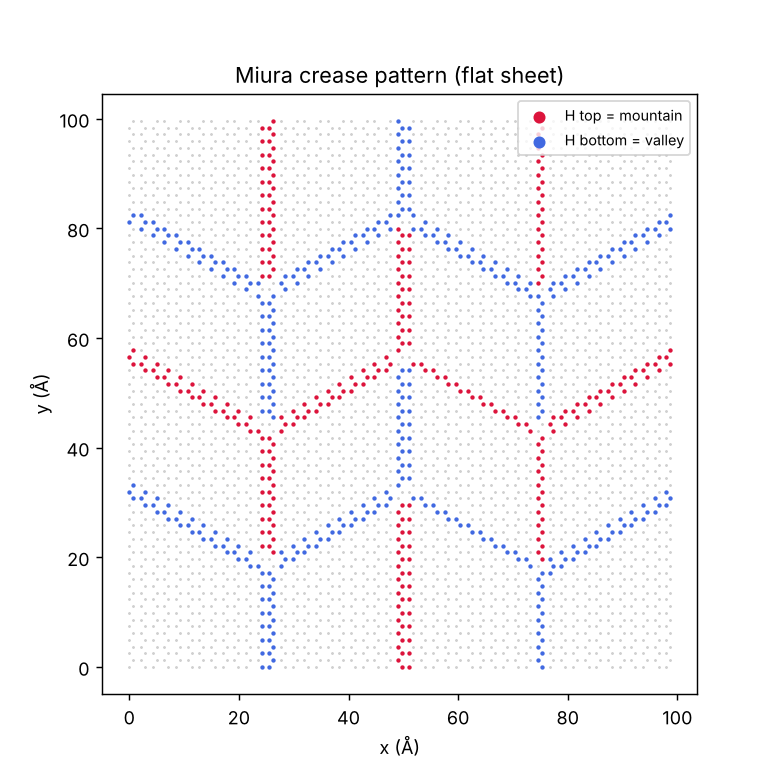

# Molecular Dynamics Simulation of Hydrogenation-Assisted Self-Folding in Graphene Miura-ori Origami


[](https://doi.org/10.5281/zenodo.24395100)
[](http://creativecommons.org/licenses/by-nc/4.0/)

A fully atomistic **molecular dynamics simulation of graphene origami that folds itself**, using LAMMPS. Crease lines are written into a single-layer graphene sheet by hydrogenating narrow strips on **one face only**. The hydrogenated carbons change from flat sp2 to puckered sp3 bonding, each strip becomes a crease, and the sheet bends away from the hydrogenated face. Mountain creases are hydrogenated on the top face and valley creases on the bottom face, so a full **Miura-ori crease lattice** can be programmed chemically and released at 300 K with no external load.

The simulation captures the **fast self-folding** of every crease in its programmed direction, the **biaxial contraction** of the sheet that is the signature of Miura folding, the **overshoot and rebound** of the panels, **van der Waals contact** between panels, and **thermal rippling** of the free sheet, using the *AIREBO potential (CH.airebo)*. A plane fit to every panel gives the signed fold angle of each crease, and the per-atom potential energy and element names are written for visualization in OVITO. Single-crease and multi-crease (tube) patterns are included as simpler test cases.


---

## Physics

The simulation captures the full self-folding response of a crease-patterned sheet at the atomistic scale:

- Single-layer graphene modeled with the AIREBO reactive potential (REBO + Lennard-Jones + torsion), which handles both C-C and C-H bonding
- Origami geometry generated by a Python script: a graphene lattice with hydrogen atoms added along the crease lines (no external CAD files)
- One-sided hydrogenation turns each crease strip from sp2 to sp3; the sheet bends away from the hydrogenated face, so the H atoms end up on the convex side of the fold
- Mountain creases carry H on the +z face and valley creases carry H on the -z face
- Miura-ori mountain/valley assignment that is flat-foldable at every vertex (Maekawa and Kawasaki conditions)
- Carbons where a mountain strip and a valley strip overlap at a vertex are left without H
- Small random out-of-plane perturbation (0.05 Angstrom) and 300 K thermal motion break the flat-sheet symmetry
- No grips and no external force: folding is driven only by the crease chemistry, and stopped or locked by panel contact (LJ)
- Nose-Hoover thermostat on all atoms; linear and angular momentum removed every 100 steps so the free sheet does not drift or spin
- Fold angle of every crease from plane fits to the panel cores, signed by whether the crease folds as programmed

---

## Folding Time Regime

| Process                                  | Time scale        | This Simulation       |
| ---------------------------------------- | ----------------- | --------------------- |
| C-H bond vibration                       | ~10 fs            | Resolved (0.5 fs step) |
| Crease opening after minimization        | < 1 ps            | Yes                   |
| Crease folding to large angles           | 2 to 6 ps         | Yes                   |
| Panel contact, rebound, settling         | 5 to 50 ps        | Yes                   |
| Experimental hydrogenation and folding   | seconds to hours  | No                    |

Hydrogenation is instantaneous here: the full crease pattern exists at time zero, and the sheet is released at 300 K. In experiments the H atoms are added over a much longer time, so the folding path can be slower and more sequential. Check seed and temperature sensitivity before drawing quantitative conclusions.

---

## Miura-ori Crease Pattern



The sheet is divided into `nx x ny` parallelogram panels by straight creases along y and zig-zag creases running along x. Red: H on the top face (mountain). Blue: H on the bottom face (valley).

| Parameter        | Script keyword | Default      | Role                                                        |
| ---------------- | -------------- | ------------ | ----------------------------------------------------------- |
| Panel columns    | `--nx`         | 4            | Number of panels along x                                    |
| Panel rows       | `--ny`         | 4            | Number of panels along y                                    |
| Panel width      | `--a`          | 25 Angstrom  | Spacing of the straight creases                             |
| Panel height     | `--b`          | 25 Angstrom  | Spacing of the zig-zag creases                              |
| Sector angle     | `--alpha`      | 60 deg       | Miura parallelogram angle; zig-zag amplitude h = a / tan(alpha) |
| Strip width      | `--width`      | 2.8 Angstrom | Width of each hydrogenated strip; wider strip folds harder  |
| Random seed      | `--seed`       | 1            | Seed for the initial z perturbation                         |

The geometry builder prints the number of C atoms, mountain H, valley H, vertex carbons without H, and the sheet size at startup.

---

## Geometry

```
Graphene sheet (units: Angstrom), top view, 4 x 4 panels:

y = 100   +------------------------------------------+  <- sheet top
          |          |          |          |          |
          |  \      /|\        /|\        /|          |  zig-zag crease j = 3 (V)
          |    \  /  |  \    /  |  \    /  |          |
          |      V   |    V     |    V     |          |
          |  \      /|\        /|\        /|          |  zig-zag crease j = 2 (M)
          |    \  /  |  \    /  |  \    /  |          |
          |      V   |    V     |    V     |          |
          |  \      /|\        /|\        /|          |  zig-zag crease j = 1 (V)
          |    \  /  |  \    /  |  \    /  |          |
          |          |          |          |          |
y =   0   +------------------------------------------+  <- sheet bottom
          x = 0     25         50         75        100

          straight creases at x = 25, 50, 75 (M/V alternate segment by segment)
          zig-zag amplitude h = 14.4 Angstrom (alpha = 60 deg)

x: armchair direction
y: zigzag direction
z: out of plane (mountain H on +z, valley H on -z)
Boundary: shrink-wrapped (s s s), no periodic images, no grips
```

- **Sheet**: single-layer graphene, 100 x 100 Angstrom (10.0 x 10.0 nm)
- **C-C bond length**: 1.42 Angstrom as built (relaxed by AIREBO during minimization)
- **C-H bond length**: 1.09 Angstrom
- **Panels**: 4 x 4 parallelograms, 25 x 25 Angstrom, sector angle 60 deg
- **Creases**: 12 zig-zag segments + 12 straight segments = 24 crease segments, 9 interior vertices
- **Strip width**: 2.8 Angstrom (about two atom rows per crease)

### Default System Size

| Component                    | Atom type | Atoms     |
| ---------------------------- | --------- | --------- |
| Carbon sheet                 | 1 (C)     | 3,854     |
| Mountain hydrogen (+z face)  | 2 (H)     | 291       |
| Valley hydrogen (-z face)    | 2 (H)     | 381       |
| Vertex carbons without H     | 1 (C)     | 21 (included in C) |
| **Total**                    | -         | **4,526** |

---

## Simulation Phases

| Phase            | Run Steps    | Simulated Time | Description                                                         |
| ---------------- | ------------ | -------------- | ------------------------------------------------------------------- |
| Geometry         | -            | -              | Python builds the crease-patterned sheet and writes `miura.data`    |
| Minimization     | up to 3,000  | -              | Conjugate gradient; the H strips buckle and every crease opens slightly |
| Self-folding     | 100,000      | 50 ps          | NVT at 300 K; the creases fold, panels touch, rebound and settle    |
| **Total MD**     | **100,000**  | **50 ps**      | -                                                                   |

The timestep is reset to 0 after the minimization, and the dump file starts there. The default `nsteps` in `in.origami` is 200,000 (100 ps); the example run used `-var nsteps 100000`.

---

## Key Event Timeline

Time increases by 1 ps per dump frame (2,000 steps of 0.5 fs). The values below are from the example run (`example_miura/`); use `miura_folds.dat` for the values of your run.

| Event                                                    | Time        | MD step         | Dump frame |
| -------------------------------------------------------- | ----------- | --------------- | ---------- |
| Sheet released at 300 K, creases slightly open           | 0 ps        | 0               | 0          |
| All 24 creases fold in the programmed direction          | ~2 ps       | ~4,000          | 2          |
| Maximum fold, mean zig-zag fold about 160 deg            | ~5 to 6 ps  | ~10,000-12,000  | 5 to 6     |
| Panels collide, LJ energy minimum (about -31 eV)         | ~6.5 ps     | ~13,000         | 6 to 7     |
| Rebound, folds open to about 87 deg (zig-zag) and 64 deg (straight) | ~12 ps | ~24,000   | 12         |
| Folds fluctuate around 110 to 130 deg (zig-zag) and 75 to 100 deg (straight) | 15 to 50 ps | 30,000-100,000 | 15 to 50 |
| End of run, footprint 0.69 (x) and 0.73 (y) of the flat sheet | 50 ps  | 100,000         | 50         |

The folding path at 300 K is stochastic. Run a few seeds (`-var seed`) before drawing conclusions about the final shape.

---

## Material Parameters

### Graphene Sheet

| Parameter             | Symbol | Value          | Unit     |
| --------------------- | ------ | -------------- | -------- |
| Structure             | -      | Honeycomb      | -        |
| C-C bond length       | b      | 1.42 (as built)| Angstrom |
| C-H bond length       | d_CH   | 1.09           | Angstrom |
| Atomic mass (C)       | m      | 12.011         | g/mol    |
| Atomic mass (H)       | m      | 1.008          | g/mol    |
| Sheet size            | -      | 100 x 100      | Angstrom |
| Temperature           | T      | 300            | K        |

### Dynamics

| Parameter            | Symbol  | Value     | Unit  |
| -------------------- | ------- | --------- | ----- |
| Timestep             | dt      | 0.0005    | ps    |
| Thermostat damping   | T_damp  | 0.05      | ps    |
| Momentum removal     | -       | every 100 | steps |
| Run length           | -       | 100,000   | steps |
| Initial velocity seed| seed    | 4928      | -     |

### Interatomic Potential

| Parameter       | Value                                                       |
| --------------- | ----------------------------------------------------------- |
| Potential file  | CH.airebo (official LAMMPS file, unmodified, included)      |
| Potential style | `airebo 3.0 1 1` (REBO + LJ with 3 sigma cut-off + torsion) |
| Type 1          | C                                                           |
| Type 2          | H (crease strips)                                           |
| pair_coeff      | `* * CH.airebo C H`                                         |
| md5 checksum    | `0b69ceeda5d6cdcb632f89b8bc9e7405`                          |

The file is used **unmodified**. Folding does not break C-C bonds, so the `rcmin_CC` change used in the kirigami fracture model is not needed. The LJ term must stay on: it is what makes the panels attract and stick when they touch.

Do not confuse `CH.airebo` with `CH.airebo-m`, which ships with LAMMPS and is a different potential (AIREBO-M, for `pair_style airebo/morse`).

### Boundary Conditions

| Group        | Condition                         | Description                                     |
| ------------ | --------------------------------- | ----------------------------------------------- |
| All atoms    | NVT at 300 K                      | Full dynamics, free self-folding                |
| All atoms    | `fix momentum` (linear + angular) | No drift or rigid-body spin of the free sheet   |
| All directions | Shrink-wrapped (s)              | No periodic images, sheet free to fold in 3D    |

---

## Governing Equations

### Miura-ori Geometry

```
h      = a / tan(alpha)                                   zig-zag amplitude
z(x)   = triangle wave, +h/2 at x = i*a (i even), -h/2 at x = i*a (i odd)

straight crease i  :  x = i*a                  i = 1 .. nx-1
zig-zag crease j   :  y = j*b + z(x)           j = 1 .. ny-1

panel of an atom   :  column = floor(x / a),  row = floor((y - z(x)) / b)
atom in a crease   :  distance to the crease line <= width / 2
```

### Mountain / Valley Assignment

```
zig-zag crease j                 :  M if j even,       V if j odd
straight segment (line i, row r) :  M if (i + r) even, V if odd

mountain  ->  H at (x, y, z + 1.09)
valley    ->  H at (x, y, z - 1.09)
carbon in both an M and a V strip  ->  no H

Maekawa at every interior vertex:  N_M - N_V = +-2
The odd crease lies between the two acute (alpha) sectors (big-little-big rule)
```

### Fold Angle and Fold Sense

```
panel core     = carbons more than 3 Angstrom from any crease strip
n_P, c_P       = unit normal (SVD plane fit) and centroid of panel P
                 n_P starts at +z and is kept pointing the same way as in the previous frame

fold angle     theta_AB = arccos( n_A . n_B )                 0 = flat, 180 = folded flat
fold sense     s_AB     = -[ n_A . (c_B - c_A) + n_B . (c_A - c_B) ]
                 s > 0 -> mountain,  s < 0 -> valley
signed angle   +theta if the sense matches the programmed M/V type, -theta otherwise
correct crease signed angle > 10 deg
```

### Footprint Contraction

```
footprint_x(t) = ( max - min of panel centroid x )(t) / ( same at t = 0 )
footprint_y(t) = ( max - min of panel centroid y )(t) / ( same at t = 0 )

Miura folding contracts the sheet in both x and y at the same time.
```

### AIREBO Potential Energy

```
E = 1/2 * sum_i sum_{j != i} [ E_REBO_ij + E_LJ_ij + sum_{k != i,j} sum_{l != i,j,k} E_tors_kijl ]

E_REBO_ij = V_R(r_ij) - b_ij * V_A(r_ij)          (bond order b_ij, handles sp2 -> sp3 at the creases)

delta E_LJ(t) = E_LJ(t) - E_LJ(0)                  negative when panels touch (vdW adhesion)
```

---

## Group Definitions

```
C        <- type 1 (all carbon atoms)
H        <- type 2 (crease hydrogens, both faces)
all      <- C + H (integrated with NVT, no fixed atoms)
```

The panel and crease groups used in the analysis are defined in `miura.json` (written by the geometry builder), not in LAMMPS.

---

## Output Files

| File                  | Frequency          | Content                                                                    |
| --------------------- | ------------------ | -------------------------------------------------------------------------- |
| `miura.data`          | once               | Crease-patterned sheet before relaxation (inspect the H pattern in OVITO)  |
| `miura.json`          | once               | Panel-core atom IDs, crease list and programmed M/V type, for the analysis |
| `origami.dump`        | every 2,000 steps  | id, type, element, x, y, z, per-atom PE (51 frames for 50 ps)              |
| `energy.dat`          | every 1,000 steps  | time-averaged REBO energy, LJ energy, carbon radius of gyration            |
| `log.lammps`          | every 1,000 steps  | Full log with thermo output                                                |
| `folded.data`         | end                | Final atomic positions (LAMMPS data format)                                |
| `miura_folds.dat`     | after run          | Signed fold angle of every crease vs time                                  |
| `miura_results.png`   | after run          | Fold angles, footprint contraction, fraction correct, LJ energy            |
| `miura_snapshots.png` | after run          | Four snapshots of the folding                                              |

### Per-Atom Quantities in `origami.dump`

| Column      | Quantity                                       |
| ----------- | ---------------------------------------------- |
| `id`        | Atom ID                                        |
| `type`      | 1 = C, 2 = H                                   |
| `element`   | C or H (OVITO uses it for radii and colours)   |
| `x y z`     | Position (Angstrom)                            |
| `c_peat`    | Per-atom potential energy (eV)                 |

### Thermo Columns in `log.lammps`

| Column     | Quantity                                 |
| ---------- | ---------------------------------------- |
| `c_eA[1]`  | REBO energy (eV)                         |
| `c_eA[2]`  | LJ (van der Waals) energy (eV)           |
| `c_eA[3]`  | Torsion energy (eV)                      |
| `c_rg`     | Radius of gyration of the carbon atoms (Angstrom) |

---

## Repository Structure

```
graphene_origami_lammps/
|
|-- make_miura_origami.py       # Builds the Miura-ori crease-patterned sheet (miura.data, miura.json)
|-- make_graphene_origami.py    # Builds single-crease, tube and cross patterns (origami.data, creases.json)
|-- in.origami                  # Main LAMMPS simulation script (minimize + 300 K self-folding)
|-- CH.airebo                   # Official AIREBO potential, unmodified
|-- analyze_miura.py            # Signed fold angles, M/V correctness, footprint, snapshots
|-- analyze_origami.py          # Fold angle per crease for the simple patterns
|-- README.md                   # This file
|
|-- miura_pattern.png           # Crease pattern of the flat sheet
|-- miura_results.png           # Example run: fold angles, footprint, LJ energy
|-- miura_snapshots.png         # Example run: four snapshots
|-- origami_results.png, snapshots.png              # Single-crease example
|-- tube_results.png, tube_snapshots.png            # Three-crease example
|
|-- example_miura/              # log.lammps, energy.dat, miura_folds.dat, folded.data, miura.json
|-- example_single/             # log.lammps, energy.dat, fold_angle.dat, folded.data
|-- example_tube/               # log.lammps, energy.dat, fold_angle.dat, folded.data
```

---

## How to Run

### Requirements

- LAMMPS (any recent version with the MANYBODY package for `pair_style airebo`): <https://www.lammps.org>
- AIREBO potential file `CH.airebo` (included in this repository and in the LAMMPS `potentials/` folder)
- Python 3 with numpy, scipy, and matplotlib
- OpenMPI for parallel runs
- OVITO for trajectory visualization: <https://www.ovito.org>

On Ubuntu or WSL:

```
sudo apt update
sudo apt install -y lammps openmpi-bin python3-numpy python3-scipy python3-matplotlib dos2unix
```

### Step 1: Choose the crease pattern

Use the defaults:

```
python3 make_miura_origami.py
```

or override them on the command line:

```
python3 make_miura_origami.py --nx 6 --ny 6 --a 40 --b 40 --alpha 60 --width 2.0
```

Simple test patterns:

```
python3 make_graphene_origami.py --pattern single --lx 80 --ly 40
python3 make_graphene_origami.py --pattern tube --ncrease 3 --lx 120 --ly 40 --width 3.2
python3 make_graphene_origami.py --pattern cross --lx 80 --ly 80
```

### Step 2: Run the simulation

Full pipeline in one line (geometry, MD, analysis):

```
python3 make_miura_origami.py && mpirun -np 8 lmp -in in.origami -var data miura.data -var nsteps 100000 && python3 analyze_miura.py miura.data origami.dump miura.json
```

Or step by step:

```
python3 make_miura_origami.py
mpirun -np 8 lmp -in in.origami -var data miura.data -var nsteps 100000
python3 analyze_miura.py miura.data origami.dump miura.json
```

Parallel with OpenMP threads instead of MPI:

```
lmp -sf omp -pk omp 8 -in in.origami -var data miura.data -var nsteps 100000
```

Change simulation settings without editing the script:

```
mpirun -np 8 lmp -in in.origami -var data miura.data -var T 600 -var seed 1234 -var nsteps 200000
```

For the simple patterns, use `-var data origami.data` and analyse with:

```
python3 analyze_origami.py origami.data origami.dump creases.json
```

The default sheet has about 4,500 atoms, so 6 to 8 processes are usually faster than 14. For larger sheets (`--a 40 --b 40 --nx 6 --ny 6`, about 24,000 atoms) use all cores. The example run took about 25 minutes on 2 OpenMP threads.

If the files were edited or extracted on Windows, convert line endings first: `dos2unix *.py in.origami`.

### Step 3: Visualize in OVITO

1. Open OVITO, then `File > Load File` and select `miura.data` to check the crease pattern (type 2 atoms above and below the sheet)
2. Load `origami.dump` for the folding trajectory (all 51 frames load as an animation)
3. The `element` column sets C and H radii and colours automatically
4. Add **Create bonds** with a uniform cut-off of 1.9 Angstrom
5. Add **Color Coding** on `Position.Z` (Rainbow) to follow the folding
6. Untick the **Particles** visual element to show only the coloured bond network, or keep particles to see the H strips
7. Use **Zoom all**; the sheet shrinks as it folds, so the view may need re-centring
8. Colour by `c_peat` to see the strained creases and the panel contact regions
9. Run `analyze_miura.py` (or plot `miura_folds.dat`) for the fold-angle curves

Each dump frame is 1 ps (frame 6 = 6 ps, frame 50 = 50 ps).

---

## What to Look for in Results

### Programmed Folding Direction

Every crease should fold the way the pattern asks: mountains up, valleys down. In the example run, all 24 creases fold correctly within about 2 ps and stay correct. The dashed line in `miura_results.png` shows the fraction of correct creases.

### Biaxial Contraction

A Miura sheet shrinks in both directions at once. The x and y footprints in `miura_results.png` fall together, to about 0.7 of the flat size at 50 ps.

### Overshoot and Rebound

The crease strips release their strain very fast. The folds overshoot to about 160 deg, panels collide (LJ energy drops by about 31 eV), and then spring back. The panels settle at intermediate angles with a large spread between creases.

### Panel Flexibility

The 2.5 nm panels bend as well as rotate, so the folded sheet looks partly crumpled rather than a clean, rigid Miura lattice. Larger panels, narrower strips and more cells give a cleaner lattice.

### Thermal Rippling

At 300 K the panels show random ripples of a few Angstrom. Rerun at a low temperature (`-var T 10`) to see the difference.

### Effect of the Crease Pattern

A wider strip gives more sp3 carbons per crease and a larger, faster fold. A larger sector angle `alpha` makes the zig-zag flatter. Compare the fold angles and footprint for different `--width`, `--alpha`, `--a` and `--b`, and against the single-crease and tube patterns.

---

## Common Errors and Fixes

| Error or symptom                                   | Cause                                                         | Fix                                                                          |
| -------------------------------------------------- | ------------------------------------------------------------- | ---------------------------------------------------------------------------- |
| `Cannot open AIREBO potential file CH.airebo`      | Potential file not in the run folder                          | Copy `CH.airebo` from this repository or from `/usr/share/lammps/potentials/` |
| `MPI_ABORT` with no message at `pair_coeff`        | Extra lines added to the top of the potential file            | Keep the original header unchanged                                           |
| Wrong energies or strange bonding                  | `CH.airebo-m` (AIREBO-M, Morse) used instead of `CH.airebo`   | Use `CH.airebo` with `pair_style airebo`                                     |
| `Cannot open file origami.data`                    | Miura geometry written to `miura.data`                        | Add `-var data miura.data` to the `lmp` command                              |
| LAMMPS error about `dump_modify element` at the `dump` line | `element` column kept but `dump_modify ... element C H` removed | Keep both lines together in `in.origami`                                   |
| Sheet stays flat or folds very little              | Strips too narrow (few or no H generated)                     | Check the H counts printed by the builder and increase `--width`             |
| Panels flop and crumple                            | Panels small relative to the crease strength                  | Increase `--a` and `--b`, or reduce `--width`                                |
| `$'\r': command not found`                         | Windows line endings                                          | `dos2unix *.py in.origami`                                                   |
| `ModuleNotFoundError: No module named 'scipy'`     | Python package missing                                        | `sudo apt install python3-scipy`                                             |
| `not enough slots` from mpirun                     | Fewer cores than `-np`                                        | Lower `-np` to the value of `nproc`, or add `--oversubscribe`                |
| mpirun refuses to start as root                    | OpenMPI safety check                                          | Add `--allow-run-as-root`, or run as a normal user                           |
| Very slow run under WSL                            | Files on a Windows drive (`/mnt/d/...`)                       | Copy the folder to the Linux home directory first                            |
| `WARNING: Proc sub-domain size < neighbor skin`    | Thin sheet split across many processors                       | Harmless; can be ignored                                                     |

---

## Extending the Model

| Extension                          | What to change                                                                   |
| ---------------------------------- | -------------------------------------------------------------------------------- |
| Cleaner Miura lattice              | `--a 40 --b 40 --nx 6 --ny 6 --width 2.0`                                        |
| Different Miura geometry           | Change `--alpha`, `--a`, `--b`                                                   |
| Gentler, slower folding            | Reduce `--width`, or hydrogenate only part of each strip                         |
| Temperature effects                | `-var T 10`, `-var T 600`, ...                                                   |
| Folding path statistics            | Repeat with `-var seed 1`, `2`, `3`, ...                                         |
| Single fold, tube, box             | `make_graphene_origami.py --pattern single / tube / cross`                       |
| Mechanical response of the folded lattice | Read `folded.data`, add grips at two edges, stretch or compress as in the kirigami model |
| Unfolding by dehydrogenation       | Delete the H atoms of chosen creases from `folded.data` and continue the run     |
| Other origami patterns             | Replace the crease lines in the builder (Kresling, Yoshimura, waterbomb)         |
| Other 2D materials                 | Fluorination or other one-sided functionalization with a suitable potential      |
| Continuum comparison               | Compare with a bar-and-hinge or shell model of the same crease pattern           |

---

## Citation

If you use this code in your research, please cite:

```
@software{mishra_2026_graphene_origami,
  author    = {Mishra, Akshansh},
  title     = {Molecular Dynamics Simulation of Hydrogenation-Assisted
               Self-Folding in Graphene Miura-ori Origami},
  year      = {2026},
  publisher = {Zenodo},
  doi       = {10.5281/zenodo.24395100},
  url       = {https://doi.org/10.5281/zenodo.24395100}
}
```

Plain text citation:

> Mishra, A. (2026). *Molecular Dynamics Simulation of Hydrogenation-Assisted Self-Folding in Graphene Miura-ori Origami* [Computer software]. Zenodo. <https://doi.org/10.5281/zenodo.24395100>

Please also cite the AIREBO potential:

> S. J. Stuart, A. B. Tutein, J. A. Harrison, "A reactive potential for hydrocarbons with intermolecular interactions", *J. Chem. Phys.* 112, 6472-6486 (2000).

---

## Author

**Akshansh Mishra**
GitHub: <https://github.com/akshansh11>

---

## License

<a rel="license" href="http://creativecommons.org/licenses/by-nc/4.0/"></a><br />
This work is licensed under a <a rel="license" href="http://creativecommons.org/licenses/by-nc/4.0/">Creative Commons Attribution-NonCommercial 4.0 International License</a>.

You are free to:

- **Share**: copy and redistribute the material in any medium or format
- **Adapt**: remix, transform, and build upon the material

Under the following terms:

- **Attribution**: You must give appropriate credit to Akshansh Mishra and provide a link to this repository
- **NonCommercial**: You may not use the material for commercial purposes

Copyright 2026 Akshansh Mishra. All rights reserved for commercial use.
